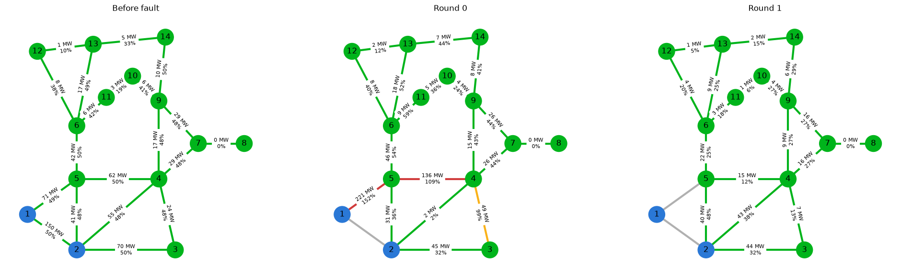
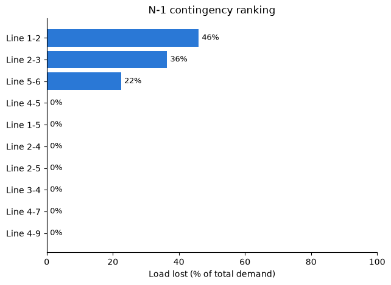
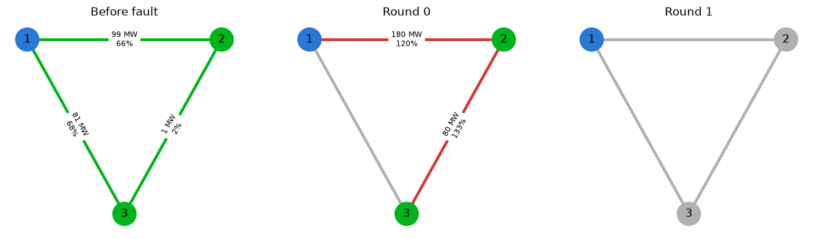

# Power Grid Cascading Failure Simulator

A Python simulator that predicts how cascading failures spread through a power grid. It solves DC power flow equations to find where power goes, trips lines that overload, and repeats until the grid settles or blacks out. Running this for every possible single-line failure (N-1 contingency analysis) shows which components the grid can't afford to lose. Built with NumPy, NetworkX and matplotlib.



*IEEE 14-bus system after line 1-2 fails. **Round 0:** generator 1's power is forced onto line 1-5 (152% of rating) and line 4-5 (109%). **Round 1:** line 1-5 trips, cutting off generator 1; the remaining generator can't cover demand, so 46% of the load is shed. Line colors show loading (green < 80%, orange 80-100%, red > 100%, gray = tripped); buses are blue (generator), green (powered) or gray (blacked out).*

## What it does

- **DC power flow:** builds the susceptance matrix from line reactances and solves for bus voltage angles and line flows.
- **Islanding:** when faults split the grid, each island is solved separately. Islands with no generation black out; islands short on generation shed load.
- **Cascading failures:** after an initial fault, lines above their thermal rating trip, power reroutes, and the loop repeats until no line is overloaded.
- **N-1 contingency analysis:** fails every line one at a time and ranks the outcomes by load lost, which is the standard reliability check grid operators run.
- **Visualization:** grid diagrams for each cascade round and a contingency ranking chart.

## Key findings (IEEE 14-bus system)



- **17 of 20** single-line failures cause no loss of load: power reroutes onto the remaining lines without overloading them.
- **3 lines are critical**: losing line 1-2 sheds 46% of the load, line 2-3 blacks out bus 3 (36%), and line 5-6 blacks out buses 6 and 10-14 on the low-voltage side (22%).
- All three are **single points of failure**: a large generator, a large load, or a whole region depending on only one or two paths. Adding a parallel line or transformer at these points would be the fix.
- **The line ratings make a big difference**: with ratings 1.25× normal flow, 11 of 20 failures cause load loss; at 2× it drops to 3, and more headroom beyond that doesn't help.
- **The relay model changes the outcome**: tripping only the most overloaded line each round (instead of all at once) saved line 4-5 during the line 1-2 cascade.

## How it works

### DC power flow

For a transmission network with flat voltage magnitudes and small angle differences, the AC power flow equations simplify to a linear system:

```
P = B · θ
```

- **P**: net power injected at each bus (generation − load), in per-unit
- **θ**: bus voltage angles
- **B**: susceptance matrix built from line reactances x:
  - off-diagonal `B[i, j] = −1/x_ij` for each line between buses i and j
  - diagonal `B[i, i] = Σ 1/x_ik`, summed over every line connected to bus i

B is singular, because angles are only defined relative to each other, so one reference bus per island is fixed at θ = 0 and the reduced system is solved. Line flows then follow from the angle differences:

```
P_ij = (θ_i − θ_j) / x_ij
```

The solver was validated against a hand calculation on the 3-bus network (flows of 98.9, 81.1 and −1.1 MW).

### Islands and power balance

After each trip, the grid is split into islands (connected components of the in-service network). Each island is balanced on its own:

- **No generator:** blackout.
- **Demand exceeds generation capacity:** every load is reduced by the same fraction (under-frequency load shedding).
- **Otherwise:** generators adjust their output to match demand.

### Cascade loop

1. Apply the initial fault.
2. Solve DC power flow.
3. Trip overloaded lines. In `worst` mode only the most overloaded line trips (closest to real relays, since the most overloaded line heats fastest); in `all` mode every overloaded line trips at once.
4. Repeat until nothing is overloaded.



*On the 3-bus network, losing line 1-3 forces all power through lines 1-2 (120%) and 2-3 (133%). With all overloaded lines tripping together, the whole grid blacks out; in `worst` mode only line 2-3 trips and bus 2 keeps its power.*

## Modeling assumptions and limitations

- **DC approximation:** lossless lines, all voltages at 1.0 per-unit, small angle differences. Reactive power and voltage are not modeled, so voltage collapse can't be captured.
- **Assumed line ratings:** the IEEE 14-bus case publishes no thermal ratings, so each line is rated at 2× its base-case flow (minimum 15 MW). Results depend on this choice, as the findings above show.
- **Generators:** buses 3, 6 and 8 are synchronous condensers in the original case and supply no real power, so only buses 1 and 2 are modeled as generators.
- **Quasi-steady-state:** relay time delays, generator dynamics and frequency response are not simulated; load shedding is instantaneous.
- **"Fault" means outage here:** this tool simulates lines and buses going out of service, not short-circuit currents (see roadmap).

## How to run

```bash
git clone https://github.com/ElhamNejrabi/power-distribution-analysis.git
cd power-distribution-analysis
python3 -m venv venv
source venv/bin/activate
pip install -r requirements.txt

python main.py                                   # full study on the IEEE 14-bus system
python main.py --network 3bus --fault 1-3        # cascade for a chosen line
python main.py --trip-mode all                   # compare relay models
python main.py --help                            # all options
```

Plots and a JSON summary of every result are saved to `outputs/`.

## Project structure

| File | Purpose |
|---|---|
| `grid_model.py` | Grid as a NetworkX graph; test networks (3-bus, 5-bus, IEEE 14-bus) |
| `fault_simulator.py` | DC power flow, island balancing, cascade simulation, N-1 analysis |
| `visualization.py` | Grid, cascade and contingency ranking plots |
| `main.py` | Command-line entry point that runs the full study |

## Roadmap

- **Short-circuit analysis:** three-phase fault currents at each bus using the impedance matrix (Z-bus), the calculation used for breaker sizing and arc-flash studies.
- **Automated tests:** checks against hand calculations and power balance at every bus.
